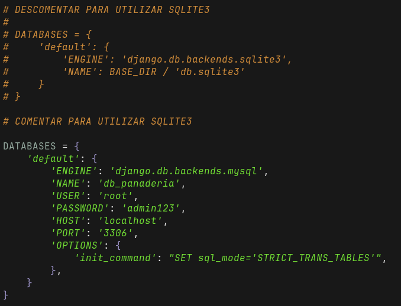

# Ingenieria de Software


## Introducción

Es un sitio web para panaderías que quieran mostrar a sus clientes los estados de preparación del pan.


## Base de Datos

Este proyecto trabaja por defecto con MySQL pero tambien se puede trabajar con Sqlite3 si se siguen algunos pasos.

Se necesita una base de datos:

### MySQL

Instalar MySQL y crear una base de datos llamada db_panaderia.

### Sqlite3

Borrar los comentarios de panaderia/settings.py y comentar la sección de MySQL.



## Usuario Administrador

Por temas de facilitar el uso del proyecto, al iniciar el servidor con runserver, si no hay usuarios en la base de datos, se crea por defecto el administrador.

Por defecto están encriptadas en la BD.

### Credenciales

#### Nombre
admin

#### Contraseña
admin

## Instalación

### Requerimientos
- Python
- Pip
- Git

#### Clonar el repositorio
```
git clone https://github.com/Felipefza/IngSoftware-Eva3
cd IngSoftware-Eva3
```

#### Linux
```
python3 -m venv .venv
source ./.venv/bin/activate
pip install -r requerimientos.txt
python3 manage.py migrate
python3 manage.py runserver
```

#### Windows
```
python -m venv .venv
./.venv/Scripts/activate
pip install -r requerimientos.txt
python manage.py migrate
python manage.py runserver
```
